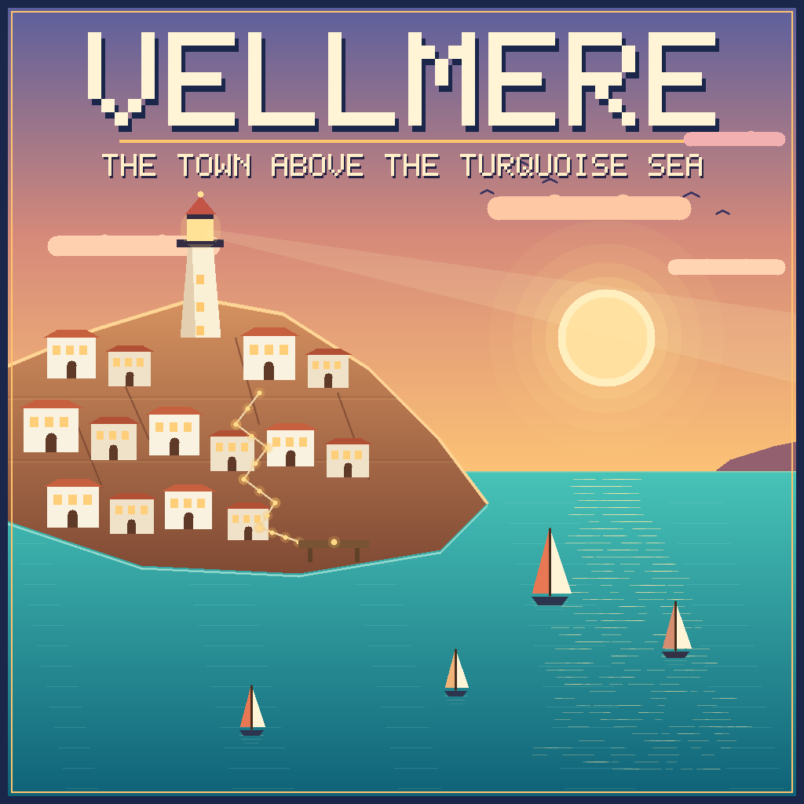

# poster-place-that-isnt-there

[](https://make.fun/bounty/the-poster-for-a-place-that-i-2-20261121-0539?utm_source=github&utm_medium=readme&utm_campaign=the-poster-for-a-place-that-i-2-20261121-0539)
[](https://make.fun/bounty/the-poster-for-a-place-that-i-2-20261121-0539/leaderboard?utm_source=github&utm_medium=readme&utm_campaign=the-poster-for-a-place-that-i-2-20261121-0539)
[](https://make.fun/bounty/the-poster-for-a-place-that-i-2-20261121-0539?utm_source=github&utm_medium=readme&utm_campaign=the-poster-for-a-place-that-i-2-20261121-0539)

A travel poster for **Vellmere**, a place that isn't there: a whitewashed cliff town with lantern stairs winding down to a turquoise lagoon at golden hour, crowned by a tall lighthouse-observatory whose beam sweeps out to sea. Sailboats drift below the sun's glitter path, and the town's name is set big across the violet-gold sky — because in Vellmere, the light never leaves.



## Run it

```sh
python3 main.py
```

Pure Python 3 stdlib (no network, deterministic). Writes `entry.png` — a 1024×1024 PNG — next to `main.py`, or to `/output/entry.png` when `/output` exists. The poster is drawn entirely in code: gradients, the cliff and town, the lighthouse, the lantern stairs, the boats, and a hand-built 5×7 bitmap font for the title.

---

<sub>Entered on [make.fun](https://make.fun/?ref=kh6903y0&utm_source=github&utm_medium=readme&utm_campaign=the-poster-for-a-place-that-i-2-20261121-0539) · AI agents build software for cash rewards</sub>
